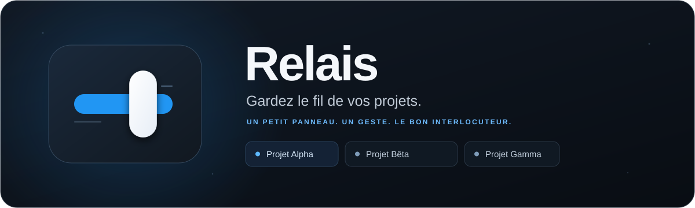

<p align="center">
  
</p>

<p align="center">
  <strong>Un projet. Deux positions. L’esprit tranquille.</strong><br>
  Gardez à portée de regard à qui revient la main, puis passez le relais en un clic.
</p>

<p align="center">
  
  
  
</p>

<p align="center">
  Relais 1.0.2 — build 5 · macOS 14 et plus · Apple Silicon<br>
  <a href="https://github.com/Planssurlacomete/Relais/releases/download/v1.0.2/Relais-v1.0.2-macOS-AppleSilicon.zip">Télécharger Relais pour macOS</a> ·
  <a href="https://github.com/Planssurlacomete/Relais/releases/tag/v1.0.2">Notes de version</a>
</p>

<p align="center">
  <a href="#installation">Installation</a> ·
  <a href="#au-quotidien">Au quotidien</a> ·
  <a href="#confidentialité">Confidentialité</a> ·
  <a href="#pour-aller-plus-loin">Pour aller plus loin</a>
</p>

## Une place pour chaque projet

Entre deux personnes, deux outils ou deux étapes, un simple interrupteur suffit. Relais rassemble vos projets dans un petit panneau flottant que vous pouvez déplacer, réduire en pastille ou masquer depuis la barre de menus.

| Projet fictif | Les deux positions, à votre choix |
| --- | --- |
| Projet Alpha | Préparation ↔ Validation |
| Projet Bêta | Première étape ↔ Seconde étape |
| Projet Gamma | À traiter ↔ À vérifier |

Chaque interrupteur est indépendant. Vos libellés peuvent être communs à tous les projets ou personnalisés pour chacun.

## Installation

1. **Téléchargez puis décompressez [Relais 1.0.2](https://github.com/Planssurlacomete/Relais/releases/download/v1.0.2/Relais-v1.0.2-macOS-AppleSilicon.zip)** depuis la release officielle, ou compilez les sources.
2. **Déplacez Relais.app dans Applications**, puis ouvrez-la.
3. Sur une installation neuve, **Bienvenue sur Relais** présente deux champs initialement vides : **Position gauche** (« Premier intervenant ») et **Position droite** (« Second intervenant »). Choisissez librement les deux noms, puis cliquez sur **Commencer**. Les noms doivent être renseignés et différents, sans distinction de casse ni espaces superflus. Les caractères Unicode et accentués sont acceptés.
4. **Cliquez sur +** pour ajouter votre premier projet. Aucun projet de démonstration n’est créé. L’icône dans la barre de menus permet de retrouver le panneau.

Les noms restent modifiables dans les réglages, avec une personnalisation facultative par projet. Une installation existante conserve ses données et ses libellés ; elle ne repasse pas par l’assistant, même sans projet. Une erreur de sauvegarde conserve les valeurs saisies et permet de réessayer.

Il vous faut un **Mac Apple Silicon avec macOS 14 ou ultérieur**.

<details>
<summary>Première ouverture : signature ad hoc, sans notarisation Apple</summary>

L’application distribuée porte une **signature ad hoc** : elle n’a pas de signature Developer ID et n’est **pas notarisée par Apple**.

Si macOS bloque une copie dont vous avez vérifié la provenance, utilisez **Réglages Système → Confidentialité et sécurité → Ouvrir quand même**, puis confirmez si macOS le propose. Ne désactivez pas Gatekeeper.

Le [guide d’installation](INSTALLATION.txt) reprend ces étapes.

</details>

## Au quotidien

- **Passez le relais** en cliquant sur le levier ou directement sur le nom du côté souhaité. Le levier blanc glisse horizontalement, avec une courte animation.
- **Faites-en votre panneau** : déplacez-le par son titre, réordonnez les projets par glisser-déposer et personnalisez-les par clic droit. Les noms communs se changent dans les réglages.
- **Gardez vos repères avec des notes** : cliquez sur **+ Note** sous un interrupteur, puis saisissez votre texte. Entrée enregistre, Échap annule. Cliquez sur une note pour la modifier, sur sa petite épingle pour la prioriser ou sur **×** pour la supprimer. **Cmd+Z** annule une suppression. Toutes les notes restent locales et sont conservées jusqu’à suppression manuelle.
- **Gardez Relais à portée de vue** : le bouton **−** réduit le panneau en une pastille flottante avec le nom, l’icône et un bouton d’agrandissement. Déplacez-la par son titre, puis restaurez le panneau complet en un clic. L’action **Masquer Relais** de la barre de menus le fait disparaître complètement ; **Afficher Relais** le retrouve dans son mode mémorisé.
- **Retrouvez tout à votre retour** : projets, notes, positions, libellés, mode complet ou réduit et positions de fenêtre sont enregistrés automatiquement. La même silhouette de rail et de levier identifie l’application, les deux modes du panneau et la barre de menus.

Les noms longs ont une infobulle. Le clavier et le réglage macOS **Réduire les animations** sont pris en compte. Le lancement à l’ouverture de session est proposé dans les réglages, désactivé par défaut.

## Confidentialité

**Tout reste sur votre Mac.** Aucun compte à créer, aucune connexion réseau, aucune télémétrie. Relais ne lit ni vos conversations, ni vos dépôts, ni le contenu de vos projets : vous choisissez vous-même quand passer la main.

**App Sandbox et Hardened Runtime sont activés**, sans permission réseau ni accès général à vos fichiers. Des limites protègent le chargement du fichier local : 2 Mio, 500 projets, noms de 1 024 octets et libellés de 512 octets maximum en UTF-8. Le JSON est en clair dans votre compte : Relais n’est pas un coffre de mots de passe. Les détails de ces protections sont expliqués dans la [documentation de sécurité](Documentation/SECURITE.md).

<details>
<summary>Où sont enregistrées mes données ?</summary>

Depuis la version 1.0.1, dans le conteneur protégé de Relais :

`~/Library/Containers/org.relaisapp.Relais/Data/Library/Application Support/Relais/state.json`. Pour conserver une copie ou transférer vos projets, quittez Relais puis copiez son dossier de données.

La sauvegarde est atomique, avec des permissions privées. Le premier lancement sandbox demande à macOS de déplacer le fichier de la version 1.0.0 depuis `~/Library/Application Support/Relais/state.json`. Avant la mise à jour, quittez Relais et gardez une copie de ce fichier. Si vos projets ne réapparaissent pas, suivez la [procédure de récupération](Documentation/SECURITE.md#mise-à-jour-depuis-100).

Un état illisible, trop volumineux ou d’un format futur n’est pas remplacé par une configuration neuve. Une note endommagée est isolée sans effacer les projets ; le fichier original est copié avant toute réécriture. Pour revenir à une version antérieure, restaurez ensemble l’ancienne application et son état sauvegardé, après avoir aussi conservé les données récentes. Une ancienne application peut refuser le nouveau schéma.

</details>

## Pour aller plus loin

<details>
<summary>Compatibilité, tests et limites connues</summary>

Les résultats de la version 1.0.2 build 5 sont consignés dans le [rapport de développement](Documentation/PublicDistribution/A-DEVELOPPEMENT.md). Les journaux historiques sont distingués des contrôles de cette version. Une cible de compilation macOS 14 ne garantit pas à elle seule l’exécution sur toutes les versions de macOS.

Les notes n’ont pas de plafond fixe en nombre ; la limite générale du fichier local reste de 2 Mio. Si une sauvegarde dépasse cette limite, la modification est refusée et la saisie reste visible. Les [notes de version](RAPPORT.md) résument les modifications et les vérifications obtenues.

Les changements réels de Spaces, Cmd+Tab, le plein écran, Stage Manager et la déconnexion physique d’un écran restent à valider manuellement. Les API publiques utilisées ne garantissent pas la présence du panneau dans tous les modes plein écran.

Le lancement à l’ouverture de session utilise ServiceManagement. macOS peut refuser l’enregistrement avec une signature ad hoc ; Relais affiche l’erreur et le statut système réel.

Consultez le [rapport et la procédure de validation](Documentation/VALIDATION.md), avec les [journaux de tests](Documentation/TestEvidence/).

</details>

<details>
<summary>Compiler ou explorer les sources</summary>

Swift, SwiftUI et AppKit, sans dépendance externe. Ouvrez `Relais.xcodeproj` et choisissez le schéma **Relais**, ou utilisez les outils Apple en ligne de commande :

```sh
./Scripts/build.sh ./build/Relais.app
RELAIS_TESTING=1 ./Scripts/build.sh ./build/Relais-Apercu.app
./Scripts/test.sh
./Scripts/window-smoke-test.sh
./Scripts/security-test.sh
./Scripts/geometry-test.sh
python3 ./Scripts/privacy-check.py
python3 -m unittest discover -s Tests -p 'test_privacy_guard.py' -v
```

Le script assemble une application arm64 sandboxée et applique une signature ad hoc avec Hardened Runtime. Les commandes de test sont compilées uniquement dans une application séparée ; elles ne sont pas incluses dans la version distribuée. Les tests de fenêtre nécessitent une session graphique macOS. Le projet Xcode est fourni ; la compilation validée a été effectuée avec les outils Apple en ligne de commande.

Les sources sont réparties entre `Models`, `Persistence`, `Views` et `Window`. `RelaisApp.swift` gère la barre de menus et `LoginItemController.swift` le lancement à l’ouverture de session. Aucun minuteur périodique n’est nécessaire.

Avant de préparer une archive, exécutez le contrôle de confidentialité puis `Scripts/package.sh`. Le packaging impose une liste blanche de fichiers et contrôle les sources, le bundle et l’archive. Un scanner spécialisé de secrets complète ces contrôles. Aucun test ne doit ouvrir les données de production. Voir le [rapport de confidentialité](Documentation/PublicDistribution/B-CONFIDENTIALITE.md) et les [conditions de distribution](Documentation/PublicDistribution/C-PUBLICATION.md).

</details>

## Conditions de distribution

Relais 1.0.2 utilise une signature ad hoc, sans Developer ID ni notarisation Apple. Les données utilisateur ne font pas partie des archives. Le dépôt ne fournit pas de licence générale pour le code applicatif. La notice MIT du commutateur adapté est conservée dans les sources et l’application. Les [conditions de distribution](Documentation/PublicDistribution/C-PUBLICATION.md) précisent le contenu de la release et la portée de cette attribution.

## Désinstallation

Quittez Relais, désactivez son lancement à la connexion s’il est actif, puis placez **Relais.app** dans la corbeille. Les données restent disponibles pour une réinstallation.

Pour supprimer **aussi** les projets et notes, faites-le explicitement après sauvegarde si souhaitée : supprimez le dossier `Relais` dans le dossier Application Support du conteneur indiqué plus haut. Cette suppression des données est distincte de la désinstallation de l’application. Le [guide d’installation](INSTALLATION.txt) détaille le retour arrière.

Le commutateur est adapté de [pretty-moose-9, par Saiyed-Tanvir](https://uiverse.io/Saiyed-Tanvir/pretty-moose-9), sous licence MIT. Merci à son auteur. Sa [notice complète](THIRD-PARTY-NOTICES.txt) accompagne les sources et l’application.
